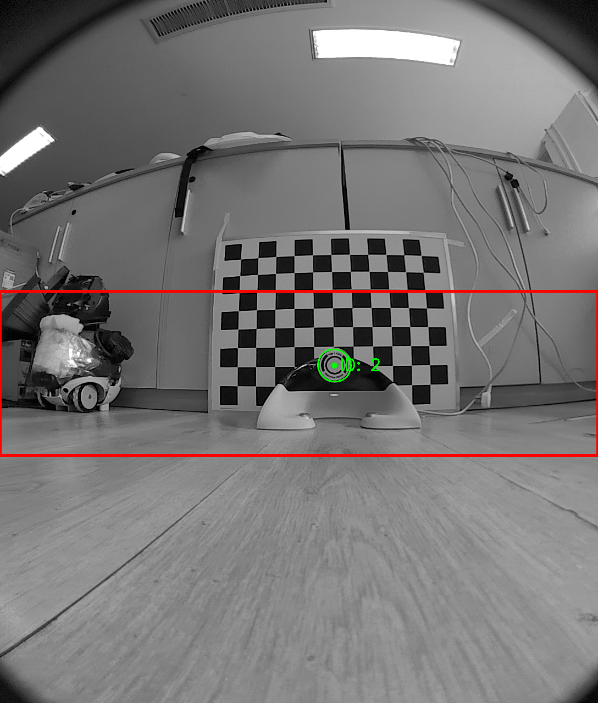
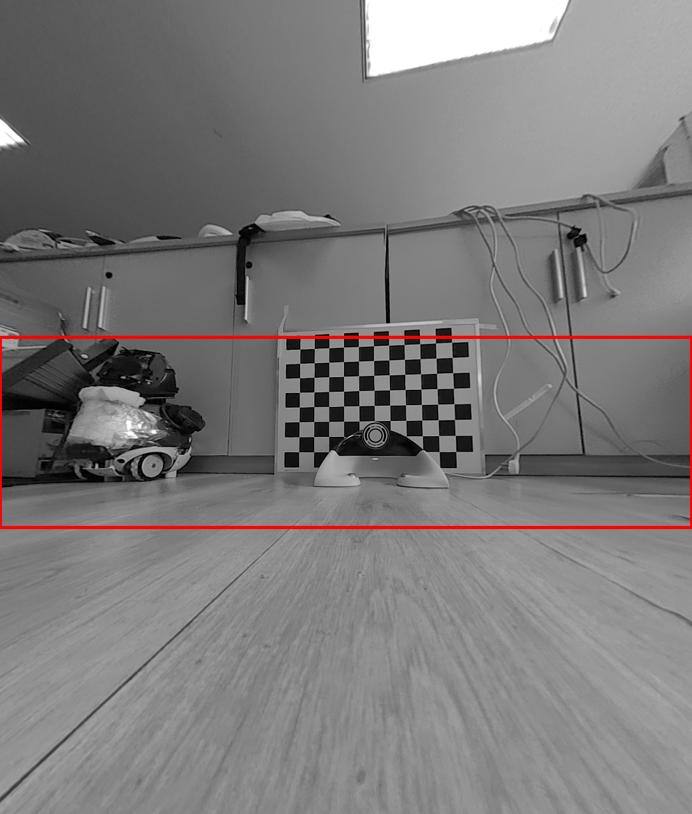
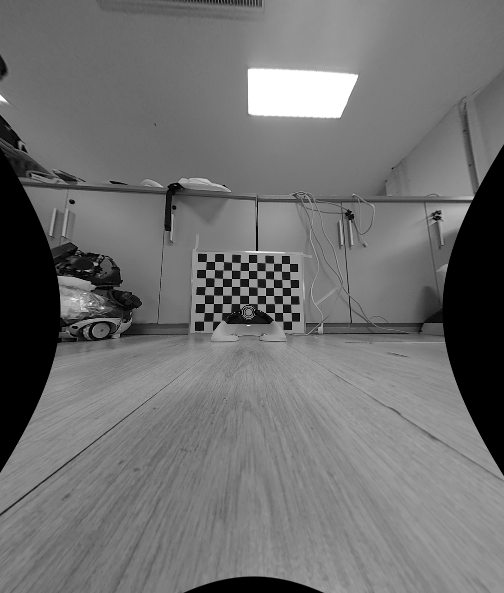
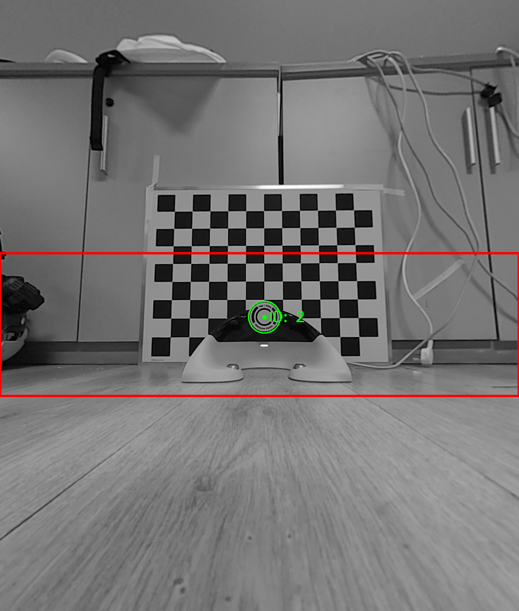

# 单一相机标定与鱼眼去畸变工程细节

> 调研日期：2026-09-20。本文记录可追溯到官方文档、源码或原始论文的事实；标有“工程推断/建议”的内容是基于这些事实的工程化落地，不应误读为 OpenCV 的硬性阈值。

## 1. 内参、外参与相机模型

### 1.1 标准针孔模型（OpenCV `calib3d`）

- OpenCV 的默认模型是针孔投影：`s p = A [R|t] P_w`。`A`（也写作 `K`）为内参矩阵，含像素单位的 `fx, fy` 和主点 `cx, cy`；`R,t` 把世界/标定板坐标变换到相机坐标。官方定义和投影方程见 [Camera Calibration and 3D Reconstruction, Detailed Description](https://docs.opencv.org/4.x/d9/d0c/group__calib3d.html)（“Pinhole camera model”段）。
- 镜头畸变扩展包括径向 `k1...k6`、切向 `p1,p2`，可选薄棱镜 `s1...s4` 和传感器倾斜 `tauX,tauY`；OpenCV 默认只返回 5 个系数，需显式设置 `CALIB_RATIONAL_MODEL`、`CALIB_THIN_PRISM_MODEL` 或 `CALIB_TILTED_MODEL` 才启用更高阶参数。[OpenCV 畸变模型与 flags](https://docs.opencv.org/4.x/d9/d0c/group__calib3d.html)
- 只要焦距固定，内参与场景无关；如果图像做了统一缩放，`fx,fy,cx,cy` 必须按相同因子缩放，而畸变系数保持不变。官方文档明确举例：从 320×240 缩放到 640×480 时，畸变系数不变，四个内参需缩放。[OpenCV intrinsic matrix and resolution scaling](https://docs.opencv.org/4.x/d9/d0c/group__calib3d.html)
- `calibrateCamera` 的每个 `rvec,tvec` 是该视角标定图案坐标到相机坐标的变换，而不是一个永远固定的“相机外参”；官方参数说明见 [`calibrateCamera` 文档](https://docs.opencv.org/4.x/d9/d0c/group__calib3d.html)。若要得到相机相对于房间/机器人基座的固定外参，必须把标定板坐标系注册到该世界坐标系（或再做 `solvePnP`/hand-eye）。

### 1.2 鱼眼/超广角模型

- 鱼眼模型不能简单地把普通 Brown–Conrady 多项式无限加阶；OpenCV 为其提供独立的 `cv::fisheye::calibrate`、`projectPoints` 和 `initUndistortRectifyMap`。鱼眼模型先对归一化半径 `r` 求角度 `theta=atan(r)`，再用 `theta` 的多项式畸变。[OpenCV fisheye camera model](https://docs.opencv.org/4.10.0/db/d58/group__calib3d__fisheye.html)
- 官方 C++ sample 以 `useFisheye` 分支调用 `fisheye::calibrate`，普通模型则调用 `calibrateCameraRO`；鱼眼默认 4 个畸变系数，普通模型初始化为 8 个。[OpenCV sample `camera_calibration.cpp`](https://github.com/opencv/opencv/blob/4.x/samples/cpp/tutorial_code/calib3d/camera_calibration/camera_calibration.cpp)（`runCalibration`）
- 工程建议（推断）：普通镜头先使用 5 参数模型；当边缘残差呈系统性、视场很宽或已知是鱼眼时，使用 `fisheye` 模型。不要通过盲目打开 `k4...k6` 来“压低”中心区域 RMS；OpenCV 警告非单调径向畸变可能在中心看似良好、在图像边缘/AR/SfM 失效。[OpenCV warning on non-monotonic distortion](https://docs.opencv.org/4.x/d9/d0c/group__calib3d.html)

## 2. 鱼眼去畸变实验：四张图应该怎样看

### 2.1 先说结论

鱼眼镜头的中心放大率高，边缘被强烈压缩；去畸变是在输出图像中重新采样，使其更接近针孔相机的均匀投影。若输出尺寸仍为 `1088×1280`，而新相机矩阵的焦距小于原始 `fx`，中心区域就会被重新映射到更少的像素，表现为**中心目标缩小**，同时边缘视场增加。

因此，“去畸变后图像尺寸没变”不等于“去畸变后中心比例没变”。图像尺寸只是输出画布的像素宽高；几何比例由输出相机矩阵 `K_new` 和畸变映射共同决定。`balance`/`alpha` 改变的是保留视场与黑边之间的取舍，不会保证中心保持原始局部焦距。

### 2.2 四张图对照

以下四张图按“原图 → 自动生成新内参 → 原内参裁切”的顺序排列：

#### 图 1：原始鱼眼图像

未调用去畸变映射的原始 `1088×1280` 图像。直线在边缘仍可能弯曲，中心局部放大率保持原始镜头成像状态。




#### 图 2：`balance=0`，尽量无黑边

`estimateNewCameraMatrixForUndistortRectify` 选择偏大的 `K_new`，优先保证有效区域填满输出画布，因此黑边较少或没有，但会牺牲一部分边缘视场。示例中 `f≈341`，约为原始 `fx=503.6` 的 `0.68` 倍；中心目标仍会按 `K_new` 的尺度缩小。



#### 图 3：`balance=1`，保留更多边缘视场

`balance=1` 偏向较小的 `K_new`，尽量保留鱼眼边缘视场，因此会出现黑边或无效区域。示例中 `f≈251`，约为原始 `fx` 的 `0.50` 倍，中心目标缩小最明显，但视场保留最多。



#### 图 4：使用原内参 `K`，再裁切有效区域

不调用自动生成的新内参，直接以原始 `K` 作为去畸变后的相机矩阵，再对结果裁切。这样中心比例更接近原始内参定义，但原始超广角边缘无法全部塞入同一输出画布，裁切会主动放弃边缘视场。



> 四张图的最终观感还受裁切窗口、插值方式和具体 `K_new` 数值影响；上面对 `balance` 的解释针对这组实验参数，不能直接当成所有相机的固定焦距比例。

### 2.3 本组实验参数和 FOV 计算

基于内参文件 `rgb_tof1_intrinsic.yaml` 的 `SECOND_CAMERA_PARAMS`（RGB fisheye 相机）：

- 图像尺寸：`1088×1280`；
- 原始内参：`fx=503.595`、`fy=503.683`、`cx=554.368`、`cy=615.149`；
- 鱼眼畸变：`k1=0.07098`、`k2=0.004519`、`k3=-0.01360`、`k4=0.002737`；
- 模型：4 参数 fisheye，`theta_d = theta(1+k1 theta^2+k2 theta^4+k3 theta^6+k4 theta^8)`。

| 输出方案        | 去畸变焦距`f` | `f/fx` | 视场取舍                         |
| --------------- | --------------: | -------: | -------------------------------- |
| `balance=1`   |          约 251 |  约 0.50 | 保留更多边缘视场，可能有黑边     |
| `balance=0`   |          约 341 |  约 0.68 | 更容易填满画布，边缘视场较少     |
| 原生`K`＋裁切 |           503.6 |     1.00 | 中心比例保持得更好，主动裁掉边缘 |

直接使用原生 `K` 去畸变时，针孔模型边缘 FOV 可按 `atan(像素边缘距离/f)` 计算，约为水平 `94.4°`、垂直 `103.5°`、对角 `118°`。原鱼眼图像由 `theta_d` 反解 `theta` 后，边缘约为水平 `116°`、垂直 `135°`、对角接近 `179°`。这说明“保留完整鱼眼视场”和“保持原始中心采样尺度”不能在同一个有限输出画布中同时完全满足。

### 2.4 实际选择建议

- 视觉算法依赖中心目标尺寸和稳定内参：使用原生 `K` 去畸变，再按需要裁切，并为裁切后的 ROI 更新主点。
- 需要尽量保留边缘目标：使用较大的 `balance`，接受黑边或后续有效区域 mask。
- 需要输出无黑边图像：使用较小的 `balance`，但重新标定/保存对应的 `K_new`，不要继续把原始 `K` 当成输出图像内参。
- 需要比较不同方案：同时保存 `K_new`、畸变参数、输出尺寸、裁切 ROI 和有效像素 mask；只保存一张图片无法复现几何关系。

## 3. 快门形式与采集时序

- **Global shutter**：所有像素同时开始、同时结束曝光，然后逐行读出，适合快速运动或相机运动；**rolling shutter**：逐行开始曝光，相邻行有固定行延迟 `tRow`，整帧读出时间与 ROI 高度相关。[Basler Electronic Shutter Types](https://docs.baslerweb.com/electronic-shutter-types)（Global/Rolling Shutter 段）
- Rolling shutter 在相机或标定板运动时会把不同行对应到不同时间的姿态，造成几何形变。Oth 等人的原始 CVPR 论文指出：RS 图像需要普通内参/畸变之外的快门时序模型（frame time、line integration time、line delay），并提出用已知棋盘/圆点图案视频估计 line delay 的方法。[Oth et al., *Rolling Shutter Camera Calibration*, CVPR 2013, DOI 10.1109/CVPR.2013.179](https://openaccess.thecvf.com/content_cvpr_2013/html/Oth_Rolling_Shutter_Camera_2013_CVPR_paper.html)；[PDF](https://www.cv-foundation.org/openaccess/content_cvpr_2013/papers/Oth_Rolling_Shutter_Camera_2013_CVPR_paper.pdf)
- 对静态单相机内参：RS 相机在板和相机都固定、短曝光且无振动时可按 global-shutter 的静态方法采集；对动态设备/运动目标：优先 global shutter，或记录并建模行延迟。Basler 也建议标定时短曝光、良好曝光、避免运动模糊，并要求标定网格保持静止。[Basler Camera Calibration](https://docs.baslerweb.com/camera-calibration)
- 工程采集规则（由上述时序模型推断）：关闭自动曝光、自动增益和自动对焦；固定帧率、ROI、触发模式、曝光和镜头焦距。若只能用 rolling shutter，使用刚性支架与静止平板，必要时用闪光灯（Basler 明确建议 flash 抑制 RS effect）。

## 4. 分辨率、ROI、焦距与标定板尺寸

### 4.1 可直接由官方模型推出的关系

归一化投影为 `u = fx * Xc/Zc + cx`、`v = fy * Yc/Zc + cy`。[OpenCV 投影方程](https://docs.opencv.org/4.x/d9/d0c/group__calib3d.html) 因而给出如下工程关系：若板上相邻特征的物理间距为 `S`、板距相机约 `Z`，其图像间距约为 `fx*S/Z`（像素）。这是公式的直接代入，不是额外经验常数。

- **分辨率/缩放**：改变采集分辨率或对图像做统一缩放时，必须用对应 `imageSize` 标定/按缩放比例更新 `fx,fy,cx,cy`；畸变系数可沿用，前提是传感器、镜头、畸变中心和裁剪方式不变。[OpenCV resolution scaling](https://docs.opencv.org/4.x/d9/d0c/group__calib3d.html)
- **ROI/裁剪**（工程推断）：ROI 改变了像素坐标原点，不能只缩放焦距；主点应转换到 ROI 坐标（例如裁剪左上角 `(x0,y0)` 后 `cx' = cx-x0, cy' = cy-y0`），最稳妥是按最终 ROI 重新标定。
- **焦距/变焦**：内参在焦距固定时可复用；变焦镜头改变焦距后必须重新标定。[OpenCV intrinsic matrix](https://docs.opencv.org/4.x/d9/d0c/group__calib3d.html)
- **板尺寸**（工程推断）：在预期工作距离 `Z` 和镜头 `fx` 下，选择 `S` 与板宽，使图案在图像中覆盖应用关心的视场；对于同一 `Z` 和目标像素覆盖率，长焦/较大 `fx` 通常需要更小板或更远距离，广角/较小 `fx` 通常需要更大板或更近距离。应让特征覆盖中心到边缘，而不是所有点都挤在中心。Basler 的验证说明指出：网格只覆盖图像小区域会得到偏低但没有代表性的误差，标定应覆盖完整图像，并采集近、远两类姿态。[Basler Camera Calibration](https://docs.baslerweb.com/camera-calibration)
- **特征像素尺寸**（工程建议，非 OpenCV 硬阈值）：在最远工作距离仍应让角点/圆心有足够像素支撑亚像素定位；可先以约 15–50 px 的相邻特征间距作为起始设计，再用实际图像检查模糊、饱和和检测稳定性。若分辨率提高而板不变，特征像素间距增大；若降采样，需增大板格物理尺寸或减小距离。

### 4.2 平板、尺度和外参

- Zhang 原始论文允许把打印图案贴到“合理刚性”的平面（例如硬书封面），但系统误差来自非平面性；OpenCV 的 `calibrateCameraRO` 专门支持 release-object 方法，可在粗略平面靶标点位不精确时释放部分物点并提升精度，但要求板在各视图相同、刚性/静止。[OpenCV `calibrateCameraRO` 文档](https://docs.opencv.org/4.x/d9/d0c/group__calib3d.html)
- `squareSize` 只定义标定板坐标的单位；在 sample 中板点按 `Point3f(j*squareSize, i*squareSize, 0)` 生成，若填毫米，输出 `tvec` 即为毫米量纲。[OpenCV sample board-point generation](https://github.com/opencv/opencv/blob/4.x/samples/cpp/tutorial_code/calib3d/camera_calibration/camera_calibration.cpp)

## 5. 标定图案如何选

OpenCV 官方 sample 支持 `CHESSBOARD`、`CHARUCOBOARD`、`CIRCLES_GRID` 和 `ASYMMETRIC_CIRCLES_GRID` 四种模式，并分别调用 `findChessboardCorners`、ChArUco detector 或 `findCirclesGrid`。[OpenCV C++ sample pattern switch](https://github.com/opencv/opencv/blob/4.x/samples/cpp/tutorial_code/calib3d/camera_calibration/camera_calibration.cpp)

| 图案                         | 适用与工程注意                                                                                                                                                                 | primary source                                                                                                                                                                                                           |
| ---------------------------- | ------------------------------------------------------------------------------------------------------------------------------------------------------------------------------ | ------------------------------------------------------------------------------------------------------------------------------------------------------------------------------------------------------------------------ |
| 黑白棋盘格                   | 角点可用`cornerSubPix` 做亚像素优化；标准流程成熟。要求完整棋盘可见，`patternSize` 是**内角点** `(columns, rows)`，行列反置会产生错误内参。                        | [`findChessboardCorners` docs](https://docs.opencv.org/4.x/d9/d0c/group__calib3d.html)；[OpenCV patternSize warning](https://docs.opencv.org/4.x/d9/d0c/group__calib3d.html)                                             |
| 对称/非对称圆点阵            | 圆心检测由`findCirclesGrid` 完成；对称/非对称由 flag 指定。非对称点坐标在官方 sample 中为 `(2*j+i%2)*squareSize, i*squareSize`。圆点板需留白边，官方文档说较宽白边更稳健。 | [`findCirclesGrid` docs](https://docs.opencv.org/4.x/d9/d0c/group__calib3d.html)；[OpenCV sample](https://github.com/opencv/opencv/blob/4.x/samples/cpp/tutorial_code/calib3d/camera_calibration/camera_calibration.cpp) |
| ChArUco（棋盘角点+ArUco ID） | OpenCV 推荐用于标定：ChArUco 角点比 ArUco marker 角点更准确，且允许遮挡/部分视图，不要求每个视角看到所有角点。                                                                 | [OpenCV Calibration with ArUco and ChArUco](https://docs.opencv.org/4.x/da/d13/tutorial_aruco_calibration.html)                                                                                                           |
| 纯 ArUco board               | 可处理遮挡/部分视图，但角点精度低于 ChArUco；仅在 ChArUco 不可用时使用。                                                                                                       | [OpenCV ArUco/ChArUco calibration](https://docs.opencv.org/4.x/da/d13/tutorial_aruco_calibration.html)                                                                                                                    |

**选择结论（工程建议）**：普通静态镜头优先高质量平面棋盘格或 ChArUco；存在遮挡、板不能完整入画或需要自动识别姿态时优先 ChArUco；圆点阵适合圆心检测更稳定的场景，但需保证白边、blob 对比度和圆点不饱和。高畸变/鱼眼要关闭过于激进的 `CALIB_CB_FAST_CHECK`（官方 sample 在鱼眼分支不启用该快速检查）。

## 6. 官方 C++ 仓库与使用方法

### 6.1 推荐仓库/文件

1. OpenCV 主仓库：[https://github.com/opencv/opencv](https://github.com/opencv/opencv)。
2. 标准单相机 C++ 示例：[`samples/cpp/tutorial_code/calib3d/camera_calibration/camera_calibration.cpp`](https://github.com/opencv/opencv/blob/4.x/samples/cpp/tutorial_code/calib3d/camera_calibration/camera_calibration.cpp)。官方教程明确指出源代码位于该目录，并支持 XML/YAML 设置文件。[OpenCV Camera Calibration tutorial](https://docs.opencv.org/5.0/tutorials/calib3d/camera_calibration/camera_calibration.html)
3. ChArUco 完整示例：`samples/cpp/tutorial_code/objectDetection/calibrate_camera_charuco.cpp`，由 [OpenCV ChArUco calibration tutorial](https://docs.opencv.org/4.x/da/d13/tutorial_aruco_calibration.html) 链接。
4. 算法实现：[`modules/calib3d/src/calibration.cpp`](https://github.com/opencv/opencv/blob/4.x/modules/calib3d/src/calibration.cpp)。

### 6.2 最小调用链（与官方 sample 对齐）

```cpp
#include <opencv2/calib3d.hpp>
#include <opencv2/imgproc.hpp>
#include <opencv2/imgcodecs.hpp>

std::vector<std::vector<cv::Point3f>> objectPoints;
std::vector<std::vector<cv::Point2f>> imagePoints;
cv::Size imageSize;

// 每个视角：检测 corners 后 cornerSubPix；objectPoints[i] 与 imagePoints[i] 一一对应。
cv::Mat K = cv::Mat::eye(3, 3, CV_64F);
cv::Mat D;
std::vector<cv::Mat> rvecs, tvecs;
double rms = cv::calibrateCamera(
    objectPoints, imagePoints, imageSize, K, D, rvecs, tvecs,
    cv::CALIB_RATIONAL_MODEL,
    cv::TermCriteria(cv::TermCriteria::COUNT + cv::TermCriteria::EPS, 100, 1e-8));
```

API 的参数/返回值、平面点初始化、PnP 初值和最终 Levenberg–Marquardt 重投影优化见 [`calibrateCamera` 官方文档](https://docs.opencv.org/4.x/d9/d0c/group__calib3d.html)。官方 sample 还用 `projectPoints` 重新投影，按所有点计算整体和每视角 RMS，并把 `camera_matrix`、`distortion_coefficients`、`extrinsic_parameters`、图像尺寸与板尺寸写入 YAML。[sample error/output code](https://github.com/opencv/opencv/blob/4.x/samples/cpp/tutorial_code/calib3d/camera_calibration/camera_calibration.cpp)

使用官方可执行示例时，先准备设置 XML/YAML（输入 camera、video 或 image list，`boardSize` 为内角点数、`squareSize` 为实际单位、pattern 可选 chessboard/charuco/circles），再运行：

```text
camera_calibration default.xml
camera_calibration -h
```

具体命令行解析、`patternSize`、`squareSize`、输出 YAML 和 `showUndistorted` 选项以仓库当前 4.x sample 为准；不同 OpenCV 发行版的示例参数可能随版本变化，不应复制旧版博客命令行。

## 7. 张正友标定法：原理与代码映射

### 7.1 平面单应性约束

Zhang 原始论文把标定板放在 `Z=0` 平面。针孔模型为 `s m~=A[R|t]M~`，因此平面点满足

`s m~ = H M~`，`H = A [r1 r2 t]`。

每个视角估计一个 3×3 单应矩阵 `H=[h1 h2 h3]`。由于旋转列向量正交且同范数，令 `B=A^{-T}A^{-1}`，得到两个线性约束：

`h1^T B h2 = 0`，`h1^T B h1 = h2^T B h2`。

这些公式、以及 `A` 的一般形式（含 skew `gamma`）见 Zhang 原始技术报告/论文：[Zhang, *A Flexible New Technique for Camera Calibration*, DOI 10.1109/34.888718](https://doi.org/10.1109/34.888718)；[作者技术报告 PDF（含完整推导）](https://users.ece.northwestern.edu/~yingwu/teaching/EECS432/Reading/Zhang_TR98.pdf)。

### 7.2 闭式解、外参和退化

1. 对每个视角用 DLT/SVD 从板点对应关系求 `H_i`。
2. 把上述两约束写成 `v_12^T b=0`、`(v_11-v_22)^T b=0`，堆叠成 `V b=0`；论文指出一般至少 3 个不同方向的平面视图可唯一确定 `b`（尺度除外），若假设 skew=0，两视图也可增加一条约束。[Zhang closed-form section](https://users.ece.northwestern.edu/~yingwu/teaching/EECS432/Reading/Zhang_TR98.pdf)
3. 从 `b` 恢复 `A`；随后 `r1=λA^{-1}h1`、`r2=λA^{-1}h2`、`r3=r1×r2`、`t=λA^{-1}h3`，并将带噪声的 `R=[r1,r2,r3]` 正交化。[Zhang extrinsic recovery](https://users.ece.northwestern.edu/~yingwu/teaching/EECS432/Reading/Zhang_TR98.pdf)
4. 纯平移或所有板面保持平行只重复同一约束，属于退化；采集时必须改变板相对于相机的俯仰/偏航/滚转，而不能只前后平移。[Zhang degeneracy analysis](https://users.ece.northwestern.edu/~yingwu/teaching/EECS432/Reading/Zhang_TR98.pdf)

### 7.3 畸变与非线性优化

- 论文先用闭式解初始化 `A,R_i,t_i`，再估计径向畸变，最后以所有视图、所有点的重投影平方误差做最大似然/Levenberg–Marquardt 优化。[Zhang recommended procedure](https://users.ece.northwestern.edu/~yingwu/teaching/EECS432/Reading/Zhang_TR98.pdf)
- OpenCV 的 `calibrateCamera` 对应实现为：初始化内参/畸变 → 用 `solvePnP` 得到各视角初始姿态 → 全局 LM 最小化重投影误差，并返回整体 RMS；见 [OpenCV algorithm steps](https://docs.opencv.org/4.x/d9/d0c/group__calib3d.html) 和 [源码 `calibration.cpp`](https://github.com/opencv/opencv/blob/4.x/modules/calib3d/src/calibration.cpp)。
- 代码中的 `findChessboardCorners`/`findCirclesGrid` 只负责检测 2D 特征；`calcBoardCornerPositions` 生成已知 3D（平面）点；`calibrateCamera` 同时求内参、畸变及每个视角的 `rvec/tvec`；`projectPoints` 再计算 RMS。这四步正对应 Zhang 的“对应点 → 单应性/初始化 → 非线性重投影优化”流程。[官方 C++ sample](https://github.com/opencv/opencv/blob/4.x/samples/cpp/tutorial_code/calib3d/camera_calibration/camera_calibration.cpp)

## 8. 面向落地的采集与验收清单（工程建议）

1. 固定镜头焦距、光圈、分辨率、ROI、帧率和曝光；变焦、重新对焦、改 ROI 或非统一缩放后重新标定。
2. 先选模型：普通镜头用针孔+Brown–Conrady；鱼眼用 `cv::fisheye`；RS 动态场景额外估计 line delay/连续时间姿态。
3. 板必须平整、刚性、尺寸可量；`squareSize` 使用真实单位并记录板版本。板宽按 `fx*S/Z` 关系和工作距离设计，采集近/中/远距离与倾斜姿态，使点覆盖中心和边缘。
4. 棋盘格要记录内角点 `(columns,rows)`；ChArUco 要固定字典、`squareLength`、`markerLength`；圆点阵要保留宽白边并固定 blob 参数。
5. 删除模糊、反光、过曝、遮挡和检测错序的帧；不以单一平均 RMS 作为唯一验收，查看每视角 RMS、边缘重投影和未参与优化的验证帧。
6. 对固定安装的“外参”定义清楚坐标链（例如 `T_camera_board`、`T_world_camera`）；OpenCV `tvec` 的方向是 object/board → camera，不要直接当成 camera → board。
