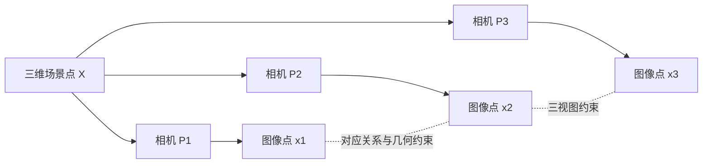
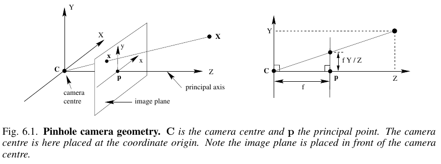

# 《计算机视觉中的多视图几何》学习综述

## 1. 学习目标

通过对话逐步学习 Richard Hartley 和 Andrew Zisserman 的 *Multiple View Geometry in Computer Vision, Second Edition*，建立从射影几何到多视图重建的完整知识链条，并能够解释主要几何关系、推导关键公式、理解估计算法及其误差来源。

本笔记记录：

- 全书结构与阅读进度；
- 对话中形成的概念解释、公式和直觉；
- 术语的中英文对应；
- 尚未解决的问题与复习线索。

## 2. 全书路线

| 部分     | 主题                       | 主要问题                                     |
| -------- | -------------------------- | -------------------------------------------- |
| 第 1 章  | 导论                       | 多视图几何研究什么，多个图像如何约束三维世界 |
| Part 0   | 背景：射影几何、变换与估计 | 如何表示几何对象，如何从带噪观测估计变换     |
| Part I   | 相机几何与单视图几何       | 相机如何投影三维点，如何标定与利用消失点     |
| Part II  | 双视图几何                 | 极线几何、基础矩阵、三角化与双视图重建       |
| Part III | 三视图几何                 | 三焦张量（trifocal tensor）及跨视图传递      |
| Part IV  | N 视图几何                 | 多视图张量、因子分解、自动标定与退化配置     |
| Part V   | 附录                       | 张量、概率统计、矩阵分解、最小二乘与迭代估计 |

建议的学习顺序是：先掌握第 1 章和 Part 0 的必要基础，再依次学习单视图、双视图、三视图和 N 视图。遇到矩阵分解、概率或优化细节时，再回看对应附录。

## 3. 贯穿全书的主线

1. **表示（representation）**：使用齐次坐标和射影空间描述点、直线、平面、相机及其变换。
2. **约束（constraint）**：多个图像中的对应点、线和相机之间满足多视图几何关系。
3. **估计（estimation）**：实际图像带有噪声，需要选择代价函数、归一化方法和鲁棒估计策略。
4. **重建（reconstruction）**：从图像对应关系恢复相机与场景结构，同时明确重建的歧义和尺度自由度。
5. **升级（stratification）**：从射影重建逐步恢复仿射、度量或欧氏结构。

## 4. 术语约定

前几次出现关键术语时给出英文，后续以中文为主。当前术语表如下：

| 中文       | English                 | 说明                                             |
| ---------- | ----------------------- | ------------------------------------------------ |
| 多视图几何 | multiple view geometry  | 研究同一三维场景在多个视点图像中的几何关系       |
| 射影几何   | projective geometry     | 允许透视投影和无穷远元素的几何框架               |
| 齐次坐标   | homogeneous coordinates | 用多一维坐标表示射影空间中的点和几何对象         |
| 相机矩阵   | camera matrix           | 描述三维点到图像点投影的矩阵                     |
| 单应性     | homography              | 两个射影平面之间的射影变换                       |
| 极线几何   | epipolar geometry       | 两个相机视图之间由相机中心和三维点决定的几何关系 |
| 基础矩阵   | fundamental matrix      | 未标定双视图中表达极线约束的矩阵                 |
| 本质矩阵   | essential matrix        | 标定相机双视图中表达相对旋转和平移的矩阵         |
| 三角化     | triangulation           | 根据多个图像观测估计三维点                       |
| 三焦张量   | trifocal tensor         | 约束三个视图中点、线对应关系的多视图张量         |
| 自动标定   | auto-calibration        | 从图像序列本身恢复相机内参数                     |
| 束调整     | bundle adjustment       | 联合优化相机参数和三维结构的非线性估计方法       |

## 5. 图示与公式约定

多视图几何中的空间关系仅靠文字不容易建立直觉，因此每次学习记录按需要补充以下内容：

- **几何示意图**：优先使用 Mermaid 或可嵌入 Markdown 的矢量图，标出相机中心、三维点、投影点、视线、平面和坐标系等对象；
- **公式**：重要公式使用独立行公式，例如

$$
\mathbf{x} \sim \mathbf{P}\mathbf{X}
$$

- **符号说明**：说明每个向量、矩阵的维度、坐标系和齐次尺度含义；
- **公式例子**：尽可能给出简单数值代入，检查公式如何产生实际图像坐标；
- **适用条件**：说明公式依赖的标定状态、非退化条件、噪声假设或坐标约定；
- **直觉解释**：把代数关系连接回“光线相交”“平面映射”或“相机运动”等几何图像。

### 多视图关系总览

这张图表达全书的基本问题：三维点通过不同相机形成多个图像观测；已知或估计这些观测之间的对应关系后，可以反过来约束相机和三维结构。

### 核心公式预览：针孔相机投影

来源：第 6 章 §6.1，原书第 154 页（PDF 第 172 页），图 6.1、公式 (6.1) 和 (6.2)。[跳转原书](./Multiple%20View%20Geometry%20in%20Computer%20Vision%20%28Second%20Edition%29.pdf#page=172)。

图中相机中心（camera centre）$C$ 位于原点，主点（principal point）$p$ 是主轴与图像平面的交点。图像平面放在相机前方，因此右侧相似三角形给出正号投影 $y=fY/Z$。

这里假设坐标已转换到相机坐标系，主点为图像坐标原点，无畸变、零斜切且两个方向焦距相同；有限投影要求 $Z\ne0$，可见场景点取 $Z>0$。原书以一致的长度单位解释 $f$ 和像平面坐标；下方像素例子将 $f$ 换成像素单位。

在齐次坐标下，三维点 $\mathbf{X}$ 通过相机矩阵 $\mathbf{P}$ 投影到图像点 $\mathbf{x}$：

$$
\mathbf{x} \sim \mathbf{P}\mathbf{X}, \qquad
\mathbf{P} \in \mathbb{R}^{3\times 4},\quad
\mathbf{X} \in \mathbb{P}^{3},\quad
\mathbf{x} \in \mathbb{P}^{2}
$$

其中 $\sim$ 表示两边只要求相差一个非零尺度。若

$$
\mathbf{P}=\begin{bmatrix} f&0&0&0\\0&f&0&0\\0&0&1&0 \end{bmatrix},
\qquad
\mathbf{X}=\begin{bmatrix}X\\Y\\Z\\1\end{bmatrix},
$$

则

$$
\mathbf{P}\mathbf{X}=\begin{bmatrix}fX\\fY\\Z\end{bmatrix}
\sim
\begin{bmatrix}fX/Z\\fY/Z\\1\end{bmatrix}.
$$

因此非齐次图像坐标为

$$
u=\frac{fX}{Z},\qquad v=\frac{fY}{Z}.
$$

例如取 $f=800$ 像素、三维点 $(X,Y,Z)=(0.5,0.25,2)$ 米，则

$$
u=800\times\frac{0.5}{2}=200\text{ 像素},\qquad
v=800\times\frac{0.25}{2}=100\text{ 像素}.
$$

这个例子也说明了透视投影的核心性质：深度 $Z$ 越大，其他坐标保持不变时，图像中的投影越靠近主点。

## 6. 学习进度

- [ ] 第 1 章：导论与全书视角
- [ ] Part 0：射影几何、变换与估计
- [ ] Part I：相机几何与单视图几何
- [ ] Part II：双视图几何
- [ ] Part III：三视图几何
- [ ] Part IV：N 视图几何
- [ ] Part V：附录与专题复习

## 7. 对话学习记录

### 学习记录模板

#### 日期：YYYY-MM-DD｜主题：

**来源**：章节/小节、原书页、PDF 页、公式号/图号及跳转链接。

**问题**：

**核心结论**：

**关键公式**：

**直觉与例子**：

**新术语**：

**待复习问题**：

## 8. 参考资料

- Richard Hartley and Andrew Zisserman, *Multiple View Geometry in Computer Vision*, Second Edition, Cambridge University Press.
- 本目录中的原始 PDF：`Multiple View Geometry in Computer Vision (Second Edition).pdf`

## 9. PDF 定位与学习状态

- [章节页码索引](./页码索引.md)：区分原书印刷页码与 PDF 物理页码，并提供跳转链接。
- [当前学习状态](./学习状态.json)：记录当前章节、页码、已整理主题、经用户确认的已掌握主题和待复习问题。
- [PDF 切分脚本](./tools/mvg_pdf.py)：按章节或页码提取文本、渲染页面、更新学习位置。

学习记录中的来源统一写成：`原书第 X 页（PDF 第 Y 页）`。PDF 物理页码由脚本根据页码偏移计算，不能把两套页码混用。

使用方法见 [学习工具说明](./tools/README.md)。恢复对话时先读状态和相关笔记，只提取本次问题所需的几页；不要因生成了预读内容就勾选已完成学习。
