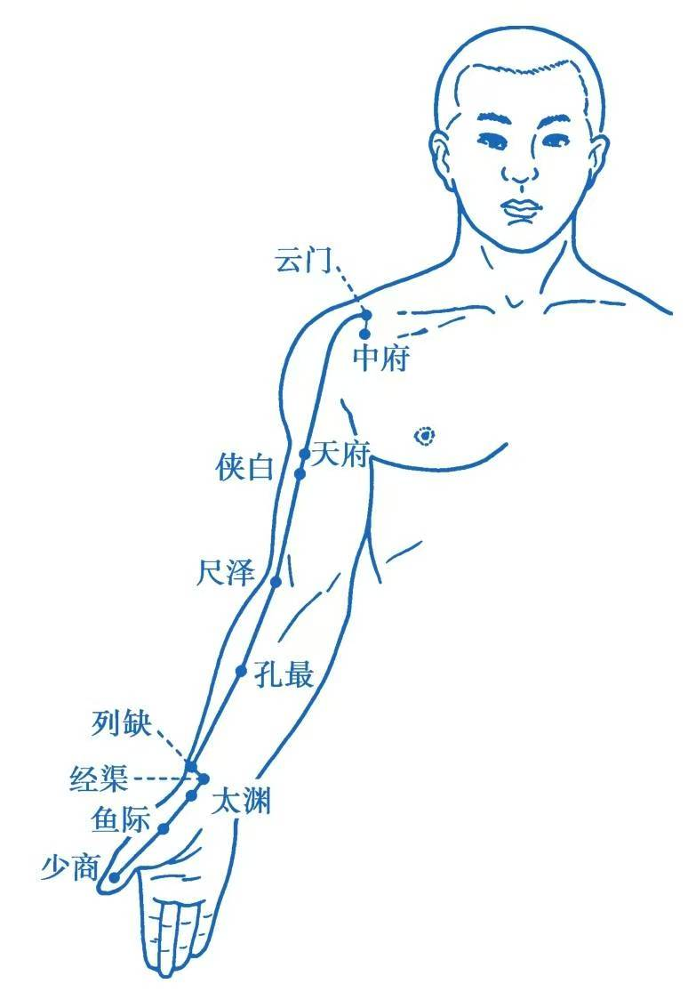

1. 肺经-手太阴肺经

中府乳上三肋间，上行云门一寸许；

云在璇玑旁六寸，天府腋三动脉求；

侠白肘上五寸主，尺泽肘中约纹是；

孔最腕后七寸拟，列缺腕上一寸半；

经渠寸口陷中取，太渊掌后横纹头；

鱼际节后散脉里，少商大指内侧端。

* **中府乳上三肋间** ：中府穴位于乳上三肋间，具体来说是在胸前壁的外上方，云门穴下1寸，平第一肋间隙，距前正中线6寸处。此穴为肺之募穴，手足太阴经交会穴，具有止咳平喘、清肺泻热、补益肺气之功效。
* **上行云门一寸许** ：云门穴在中府穴上方一寸许，具体位置在胸前壁的外上方，肩胛骨喙突上方，锁骨下窝凹陷处，距前正中线6寸。此穴具有宣肺止咳、化痰散结、泻肺清热之功效，主治咳嗽、气喘、胸痛等肺系疾病。
* **云在璇玑旁六寸** ：此句进一步描述了云门穴的位置，指出其位于璇玑穴（任脉穴位，位于颈前窝中央）旁开六寸处。**锁骨中线-乳中线到璇矶是4寸，再外开二寸**
* **天府腋三动脉求** ：天府穴位于腋下三寸处，具体来说是在臂内侧面，肱二头肌桡侧缘，腋前纹头下3寸处。**肘横纹到腋横纹是9寸，取上三分之一处**。此穴具有宣肺止咳、祛风止痒之功效，主治咳嗽、气喘、鼻衄等肺系疾病以及瘿气、上臂内侧痛等。
* **侠白肘上五寸主** ：侠白穴位于肘上五寸处，具体来说是在臂内侧面，肱二头肌桡侧缘，腋前纹头下4寸，或肘横纹上5寸处。此穴具有宣肺止咳、宽胸和胃之功效，主治咳嗽、气喘、干呕等肺胃疾病以及上臂内侧痛等。
* **尺泽肘中约纹是** ：尺泽穴位于肘中约纹处，需要曲肘仰掌前臂垫起来，在肘横纹中，肱二头肌腱桡侧凹陷处。此穴为肺经合穴，具有清热润肺、止咳平喘、通络止痛之功效，主治咳嗽、气喘、咯血等肺系实热证以及肘臂挛痛等。
* **孔最腕后七寸拟** ：孔最穴位于腕后七寸处，具体来说是在前臂掌面桡侧，肘横纹到腕横纹是一尺二，当尺泽与太渊连线上，腕横纹上7寸处。此穴为肺经郄穴，具有清热止血、润肺理气之功效，主治咯血、咳嗽、气喘等肺系疾病以及咽喉肿痛、肘臂挛痛等。
* **列缺腕上一寸半** ：列缺穴位于腕上一寸半处，具体来说是在前臂桡侧缘，桡骨茎突上方，腕横纹上1.5寸，当肱桡肌与拇长展肌腱之间。需要侧向垫起手腕，此穴为肺经络穴，八脉交会穴之一，通任脉，具有宣肺止咳、疏风解表、通经活络之功效，主治咳嗽、气喘、咽喉肿痛等肺系疾病以及头痛、项强、口眼歪斜等头面五官疾病。
* **经渠寸口陷中取** ：经渠穴位于寸口陷中处，具体来说是在桡骨茎突与桡动脉之间，腕横纹上1寸处。此穴具有宣肺理气、清肺降逆之功效，主治咳嗽、气喘、胸痛等肺系疾病。
* **太渊掌后横纹头** ：太渊穴位于掌后横纹头处，具体来说是在腕掌侧横纹桡侧，桡动脉搏动处。此穴为肺经原穴，八会穴之脉会，具有止咳化痰、通调血脉之功效，主治咳嗽、气喘、咯血等肺系疾病以及无脉症、腕臂痛等。
* **鱼际节后散脉里** ：鱼际穴位于节后散脉里处，具体来说是在手拇指本节（第一掌指关节）后凹陷处，约当第一掌骨中点桡侧，赤白肉际处。此穴具有清肺泄热、利咽止痛之功效，主治咳嗽、咯血、咽干等肺系热证以及咽喉肿痛、失音等。
* **少商大指内侧端** ：少商穴位于大指内侧端处，具体来说是在拇指桡侧指甲角旁0.1寸处。此穴为肺经井穴，具有开窍醒神、泄热通络之功效，主治咽喉肿痛、鼻衄、高热等肺系实热证以及昏迷、癫狂等急症。
* **鼻衄喉痹刺可已** ：此句总结了手太阴肺经穴位对于鼻衄、喉痹等病症的治疗作用。
