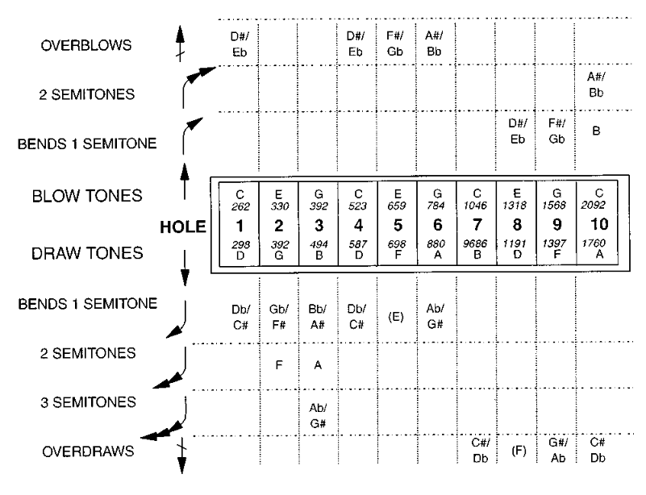
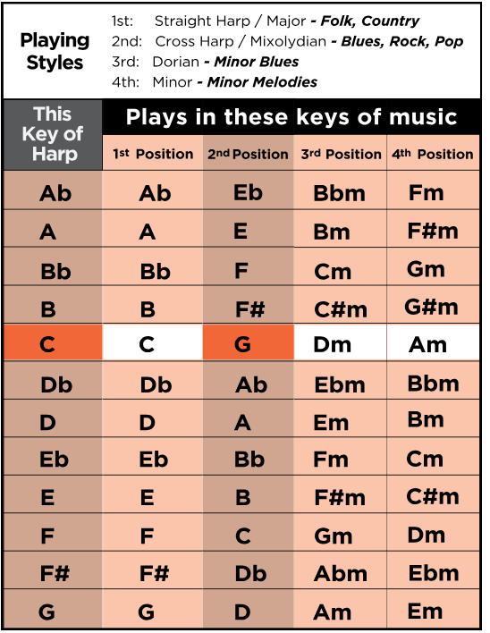

# 十孔口琴把位示意图


## 1. 把位与读图方法

**同一孔的实际音高不因把位改变；改变的是主音及其相对音级。** 例如 C 调琴的 4 孔吸音始终是 D：在二把位 G 中是 `5`，一把位 C 中是 `2`，三把位 D 中是 `1`。

| 把位                 | 主音与琴调关系                   | C 调琴示例                       | 常用主音孔位    |
| -------------------- | -------------------------------- | -------------------------------- | --------------- |
| 二把位 Cross Harp    | 琴调上方纯五度                   | G 为主音，常用于 blues           | 2D、3B、6B、9B  |
| 一把位 Straight Harp | 主音与琴调相同                   | C 为主音                         | 1B、4B、7B、10B |
| 三把位               | 琴调上方大二度（五度圈再走一步） | D 为主音，常用于小调色彩及 blues | 1D、4D、8D      |

三把位不自动等于自然小调。例如 C 调琴以 D 为中心时，自然音包含 B，即 D 的大六度；要演奏 D 自然小调所需的 B♭，仍需选用相应技巧音。把位也不保证整首歌的所有和弦都适合直接多孔吹吸。[Lee Oskar 把位与音位资料](https://leeoskarharmonicas.com/resources/)

- `B` = 吹（blow），`D` = 吸（draw）；例如 `3D↓2` 为 3 孔吸压两个半音。这里的 B、D 是动作缩写，表格内的 B4、D5 则是音名。
- `OB` = 超吹，`OD` = 超吸；例如 `6OB`。不是大力吹吸，也不是高八度。
- 实际音高用科学音高记号：C4 是中央 C，C5 高一个八度。表内统一采用简洁的等音写法，如 D♭ 写 C♯、G♯ 写 A♭；**方便找键，不代表严格的调内拼写**。
- `—` 表示此表不列该方式的独立半音目标，不代表簧片完全不能微调。

## 2. 压音、超吹和超吸带来什么音

普通压音在同孔自然吹吸音之间降低较高的那个音：低音区主要吸压，高音区主要吹压。表格列可练习的半音落点，实际滑音是连续的。

| 技巧    | 主要孔位及降幅                                        | C 调琴例子                                 |
| ------- | ----------------------------------------------------- | ------------------------------------------ |
| 吸压    | 1、4、6 孔各 1 半音；2 孔最多 2 半音；3 孔最多 3 半音 | 3D：B4 → B♭4 → A4 → A♭4               |
| 吹压    | 8、9 孔各 1 半音；10 孔最多 2 半音                    | 10B：C7 → B6 → B♭6                      |
| 超吹 OB | 1–6 孔；基本目标在同孔自然吸音上方半音               | 6OB：B♭5，比较 6D=A5，而不是 6B=G5 升半音 |
| 超吸 OD | 7–10 孔；基本目标在同孔自然吹音上方半音              | 7OD：C♯6，比较 7B=C6                      |

5 孔吸音和 7 孔吹音可有小幅音高变化，但不列为常规新增整半音。补齐缺音最常用的是 **1、4、5、6 孔超吹与 7、9、10 孔超吸**；2OB、3OB、8OD 的基本音与其他孔已有音重复，仍列出供查阅。超吹/超吸进一步上弯的扩展音不在本入门表内。

超吹/超吸需要控制口腔共鸣与簧片状态，稳定性取决于技术和琴的调校，不能保证每把出厂琴都容易发出。下表是目标音高，不是用力程度表。[Bahnson 等，1998，口琴声学实验与音位图 Fig. 2](<https://www.cs.bu.edu/fac/snyder/TablatureWeb/Bahnson%20JASA%201998.pdf>)



## 3. 二、一、三把位的通用音级图

数字以**当前把位主音为 1、其大调音阶为参照**，所以 `♭3` 表示小三度，`♭7` 表示小七度；此处不是固定调唱名。为了简洁，这三张表只标音级，不标八度；实际八度见后面的各调表。

### 二把位

| 孔号        | 1   | 2   | 3   | 4   | 5   | 6   | 7   | 8   | 9   | 10  |
| ----------- | --- | --- | --- | --- | --- | --- | --- | --- | --- | --- |
| 自然吹 B    | 4   | 6   | 1   | 4   | 6   | 1   | 4   | 6   | 1   | 4   |
| 自然吸 D    | 5   | 1   | 3   | 5   | ♭7 | 2   | 3   | 5   | ♭7 | 2   |
| 压 1 半音   | ♭5 | 7   | ♭3 | ♭5 | —  | ♭2 | —  | —  | —  | —  |
| 压 2 半音   | —  | ♭7 | 2   | —  | —  | —  | —  | —  | —  | —  |
| 压 3 半音   | —  | —  | ♭2 | —  | —  | —  | —  | —  | —  | —  |
| 吹压 1 半音 | —  | —  | —  | —  | —  | —  | —  | ♭6 | 7   | 3   |
| 吹压 2 半音 | —  | —  | —  | —  | —  | —  | —  | —  | —  | ♭3 |
| 超吹 OB     | ♭6 | ♭2 | 4   | ♭6 | 7   | ♭3 | —  | —  | —  | —  |
| 超吸 OD     | —  | —  | —  | —  | —  | —  | ♭5 | ♭7 | ♭2 | ♭5 |

### 一把位

| 发音方式 / 孔号 | 1   | 2   | 3   | 4   | 5   | 6   | 7   | 8   | 9   | 10  |
| --------------- | --- | --- | --- | --- | --- | --- | --- | --- | --- | --- |
| 自然吹音 B      | 1   | 3   | 5   | 1   | 3   | 5   | 1   | 3   | 5   | 1   |
| 自然吸音 D      | 2   | 5   | 7   | 2   | 4   | 6   | 7   | 2   | 4   | 6   |
| 吸压 1 半音     | ♭2 | ♭5 | ♭7 | ♭2 | —  | ♭6 | —  | —  | —  | —  |
| 吸压 2 半音     | —  | 4   | 6   | —  | —  | —  | —  | —  | —  | —  |
| 吸压 3 半音     | —  | —  | ♭6 | —  | —  | —  | —  | —  | —  | —  |
| 吹压 1 半音     | —  | —  | —  | —  | —  | —  | —  | ♭3 | ♭5 | 7   |
| 吹压 2 半音     | —  | —  | —  | —  | —  | —  | —  | —  | —  | ♭7 |
| 超吹 OB         | ♭3 | ♭6 | 1   | ♭3 | ♭5 | ♭7 | —  | —  | —  | —  |
| 超吸 OD         | —  | —  | —  | —  | —  | —  | ♭2 | 4   | ♭6 | ♭2 |

### 三把位

| 发音方式 / 孔号 | 1   | 2   | 3   | 4   | 5   | 6   | 7   | 8   | 9   | 10  |
| --------------- | --- | --- | --- | --- | --- | --- | --- | --- | --- | --- |
| 自然吹音 B      | ♭7 | 2   | 4   | ♭7 | 2   | 4   | ♭7 | 2   | 4   | ♭7 |
| 自然吸音 D      | 1   | 4   | 6   | 1   | ♭3 | 5   | 6   | 1   | ♭3 | 5   |
| 吸压 1 半音     | 7   | 3   | ♭6 | 7   | —  | ♭5 | —  | —  | —  | —  |
| 吸压 2 半音     | —  | ♭3 | 5   | —  | —  | —  | —  | —  | —  | —  |
| 吸压 3 半音     | —  | —  | ♭5 | —  | —  | —  | —  | —  | —  | —  |
| 吹压 1 半音     | —  | —  | —  | —  | —  | —  | —  | ♭2 | 3   | 6   |
| 吹压 2 半音     | —  | —  | —  | —  | —  | —  | —  | —  | —  | ♭6 |
| 超吹 OB         | ♭2 | ♭5 | ♭7 | ♭2 | 3   | ♭6 | —  | —  | —  | —  |
| 超吸 OD         | —  | —  | —  | —  | —  | —  | 7   | ♭3 | ♭5 | 7   |

例如 C 调琴二把位的低音区 blues 音阶可练：

```text
孔位：2D → 3D↓1 → 4B → 4D↓1 → 4D → 5D → 6B
音名：G4 → B♭4  → C5 → C♯5  → D5 → F5 → G5
音级：1  → ♭3   → 4  → ♭5   → 5  → ♭7 → 1（高八度）
```

先练自然单音与压音落点，再加超吹/超吸；“能发出声音”和“能在乐句中稳定奏准”是不同阶段。

## 4. 十二调选择速查

按二把位常见 blues 演奏调 E、A、G、D、C、F 开始，随后列其余调，便于查阅；这是本文的练习顺序，**不是严格的流行度排名**。表头“口琴调”是琴壳标识，二/一/三把位栏是演奏主音。



| 口琴调 | 二把位主音 | 一把位主音 | 三把位主音 | 本表 1 孔吹音 |
| ------ | ---------- | ---------- | ---------- | ------------- |
| A      | E          | A          | B          | A3            |
| D      | A          | D          | E          | D4            |
| C      | G          | C          | D          | C4            |
| G      | D          | G          | A          | G3            |
| F      | C          | F          | G          | F4            |
| B♭    | F          | B♭        | C          | B♭3          |
| E♭    | B♭        | E♭        | F          | E♭4          |
| E      | B          | E          | F♯        | E4            |
| A♭    | E♭        | A♭        | B♭        | A♭3          |
| D♭    | A♭        | D♭        | E♭        | C♯4          |
| B      | F♯        | B          | C♯        | B3            |
| F♯    | C♯        | F♯        | A♭        | F♯4          |

## 5. 各调逐孔音高图（含压音、超吹和超吸）

每把琴只需查一张实际音高表，再配合第 3 节的把位音级表使用。换把位不会改动下面这些音。

### A 调琴：二把位 E / 一把位 A / 三把位 B

| 发音方式 / 孔号 | 1    | 2    | 3    | 4    | 5    | 6    | 7    | 8    | 9    | 10   |
| --------------- | ---- | ---- | ---- | ---- | ---- | ---- | ---- | ---- | ---- | ---- |
| 自然吹音 B      | A3   | C♯4 | E4   | A4   | C♯5 | E5   | A5   | C♯6 | E6   | A6   |
| 自然吸音 D      | B3   | E4   | A♭4 | B4   | D5   | F♯5 | A♭5 | B5   | D6   | F♯6 |
| 吸压 1 半音     | B♭3 | E♭4 | G4   | B♭4 | —   | F5   | —   | —   | —   | —   |
| 吸压 2 半音     | —   | D4   | F♯4 | —   | —   | —   | —   | —   | —   | —   |
| 吸压 3 半音     | —   | —   | F4   | —   | —   | —   | —   | —   | —   | —   |
| 吹压 1 半音     | —   | —   | —   | —   | —   | —   | —   | C6   | E♭6 | A♭6 |
| 吹压 2 半音     | —   | —   | —   | —   | —   | —   | —   | —   | —   | G6   |
| 超吹 OB         | C4   | F4   | A4   | C5   | E♭5 | G5   | —   | —   | —   | —   |
| 超吸 OD         | —   | —   | —   | —   | —   | —   | B♭5 | D6   | F6   | B♭6 |

### D 调琴：二把位 A / 一把位 D / 三把位 E

| 发音方式 / 孔号 | 1    | 2    | 3    | 4    | 5    | 6    | 7    | 8    | 9    | 10   |
| --------------- | ---- | ---- | ---- | ---- | ---- | ---- | ---- | ---- | ---- | ---- |
| 自然吹音 B      | D4   | F♯4 | A4   | D5   | F♯5 | A5   | D6   | F♯6 | A6   | D7   |
| 自然吸音 D      | E4   | A4   | C♯5 | E5   | G5   | B5   | C♯6 | E6   | G6   | B6   |
| 吸压 1 半音     | E♭4 | A♭4 | C5   | E♭5 | —   | B♭5 | —   | —   | —   | —   |
| 吸压 2 半音     | —   | G4   | B4   | —   | —   | —   | —   | —   | —   | —   |
| 吸压 3 半音     | —   | —   | B♭4 | —   | —   | —   | —   | —   | —   | —   |
| 吹压 1 半音     | —   | —   | —   | —   | —   | —   | —   | F6   | A♭6 | C♯7 |
| 吹压 2 半音     | —   | —   | —   | —   | —   | —   | —   | —   | —   | C7   |
| 超吹 OB         | F4   | B♭4 | D5   | F5   | A♭5 | C6   | —   | —   | —   | —   |
| 超吸 OD         | —   | —   | —   | —   | —   | —   | E♭6 | G6   | B♭6 | E♭7 |

### C 调琴：二把位 G / 一把位 C / 三把位 D

| 发音方式 / 孔号 | 1    | 2    | 3    | 4    | 5    | 6    | 7    | 8    | 9    | 10   |
| --------------- | ---- | ---- | ---- | ---- | ---- | ---- | ---- | ---- | ---- | ---- |
| 自然吹音 B      | C4   | E4   | G4   | C5   | E5   | G5   | C6   | E6   | G6   | C7   |
| 自然吸音 D      | D4   | G4   | B4   | D5   | F5   | A5   | B5   | D6   | F6   | A6   |
| 吸压 1 半音     | C♯4 | F♯4 | B♭4 | C♯5 | —   | A♭5 | —   | —   | —   | —   |
| 吸压 2 半音     | —   | F4   | A4   | —   | —   | —   | —   | —   | —   | —   |
| 吸压 3 半音     | —   | —   | A♭4 | —   | —   | —   | —   | —   | —   | —   |
| 吹压 1 半音     | —   | —   | —   | —   | —   | —   | —   | E♭6 | F♯6 | B6   |
| 吹压 2 半音     | —   | —   | —   | —   | —   | —   | —   | —   | —   | B♭6 |
| 超吹 OB         | E♭4 | A♭4 | C5   | E♭5 | F♯5 | B♭5 | —   | —   | —   | —   |
| 超吸 OD         | —   | —   | —   | —   | —   | —   | C♯6 | F6   | A♭6 | C♯7 |

### G 调琴：二把位 D / 一把位 G / 三把位 A

| 发音方式 / 孔号 | 1    | 2    | 3    | 4    | 5    | 6    | 7    | 8    | 9    | 10   |
| --------------- | ---- | ---- | ---- | ---- | ---- | ---- | ---- | ---- | ---- | ---- |
| 自然吹音 B      | G3   | B3   | D4   | G4   | B4   | D5   | G5   | B5   | D6   | G6   |
| 自然吸音 D      | A3   | D4   | F♯4 | A4   | C5   | E5   | F♯5 | A5   | C6   | E6   |
| 吸压 1 半音     | A♭3 | C♯4 | F4   | A♭4 | —   | E♭5 | —   | —   | —   | —   |
| 吸压 2 半音     | —   | C4   | E4   | —   | —   | —   | —   | —   | —   | —   |
| 吸压 3 半音     | —   | —   | E♭4 | —   | —   | —   | —   | —   | —   | —   |
| 吹压 1 半音     | —   | —   | —   | —   | —   | —   | —   | B♭5 | C♯6 | F♯6 |
| 吹压 2 半音     | —   | —   | —   | —   | —   | —   | —   | —   | —   | F6   |
| 超吹 OB         | B♭3 | E♭4 | G4   | B♭4 | C♯5 | F5   | —   | —   | —   | —   |
| 超吸 OD         | —   | —   | —   | —   | —   | —   | A♭5 | C6   | E♭6 | A♭6 |

### F 调琴：二把位 C / 一把位 F / 三把位 G

| 发音方式 / 孔号 | 1    | 2    | 3    | 4    | 5    | 6    | 7    | 8    | 9    | 10   |
| --------------- | ---- | ---- | ---- | ---- | ---- | ---- | ---- | ---- | ---- | ---- |
| 自然吹音 B      | F4   | A4   | C5   | F5   | A5   | C6   | F6   | A6   | C7   | F7   |
| 自然吸音 D      | G4   | C5   | E5   | G5   | B♭5 | D6   | E6   | G6   | B♭6 | D7   |
| 吸压 1 半音     | F♯4 | B4   | E♭5 | F♯5 | —   | C♯6 | —   | —   | —   | —   |
| 吸压 2 半音     | —   | B♭4 | D5   | —   | —   | —   | —   | —   | —   | —   |
| 吸压 3 半音     | —   | —   | C♯5 | —   | —   | —   | —   | —   | —   | —   |
| 吹压 1 半音     | —   | —   | —   | —   | —   | —   | —   | A♭6 | B6   | E7   |
| 吹压 2 半音     | —   | —   | —   | —   | —   | —   | —   | —   | —   | E♭7 |
| 超吹 OB         | A♭4 | C♯5 | F5   | A♭5 | B5   | E♭6 | —   | —   | —   | —   |
| 超吸 OD         | —   | —   | —   | —   | —   | —   | F♯6 | B♭6 | C♯7 | F♯7 |

### B♭ 调琴：二把位 F / 一把位 B♭ / 三把位 C

| 发音方式 / 孔号 | 1    | 2    | 3    | 4    | 5    | 6    | 7    | 8    | 9    | 10   |
| --------------- | ---- | ---- | ---- | ---- | ---- | ---- | ---- | ---- | ---- | ---- |
| 自然吹音 B      | B♭3 | D4   | F4   | B♭4 | D5   | F5   | B♭5 | D6   | F6   | B♭6 |
| 自然吸音 D      | C4   | F4   | A4   | C5   | E♭5 | G5   | A5   | C6   | E♭6 | G6   |
| 吸压 1 半音     | B3   | E4   | A♭4 | B4   | —   | F♯5 | —   | —   | —   | —   |
| 吸压 2 半音     | —   | E♭4 | G4   | —   | —   | —   | —   | —   | —   | —   |
| 吸压 3 半音     | —   | —   | F♯4 | —   | —   | —   | —   | —   | —   | —   |
| 吹压 1 半音     | —   | —   | —   | —   | —   | —   | —   | C♯6 | E6   | A6   |
| 吹压 2 半音     | —   | —   | —   | —   | —   | —   | —   | —   | —   | A♭6 |
| 超吹 OB         | C♯4 | F♯4 | B♭4 | C♯5 | E5   | A♭5 | —   | —   | —   | —   |
| 超吸 OD         | —   | —   | —   | —   | —   | —   | B5   | E♭6 | F♯6 | B6   |

### E♭ 调琴：二把位 B♭ / 一把位 E♭ / 三把位 F

| 发音方式 / 孔号 | 1    | 2    | 3    | 4    | 5    | 6    | 7    | 8    | 9    | 10   |
| --------------- | ---- | ---- | ---- | ---- | ---- | ---- | ---- | ---- | ---- | ---- |
| 自然吹音 B      | E♭4 | G4   | B♭4 | E♭5 | G5   | B♭5 | E♭6 | G6   | B♭6 | E♭7 |
| 自然吸音 D      | F4   | B♭4 | D5   | F5   | A♭5 | C6   | D6   | F6   | A♭6 | C7   |
| 吸压 1 半音     | E4   | A4   | C♯5 | E5   | —   | B5   | —   | —   | —   | —   |
| 吸压 2 半音     | —   | A♭4 | C5   | —   | —   | —   | —   | —   | —   | —   |
| 吸压 3 半音     | —   | —   | B4   | —   | —   | —   | —   | —   | —   | —   |
| 吹压 1 半音     | —   | —   | —   | —   | —   | —   | —   | F♯6 | A6   | D7   |
| 吹压 2 半音     | —   | —   | —   | —   | —   | —   | —   | —   | —   | C♯7 |
| 超吹 OB         | F♯4 | B4   | E♭5 | F♯5 | A5   | C♯6 | —   | —   | —   | —   |
| 超吸 OD         | —   | —   | —   | —   | —   | —   | E6   | A♭6 | B6   | E7   |

### E 调琴：二把位 B / 一把位 E / 三把位 F♯

| 发音方式 / 孔号 | 1    | 2    | 3    | 4    | 5    | 6    | 7    | 8    | 9    | 10   |
| --------------- | ---- | ---- | ---- | ---- | ---- | ---- | ---- | ---- | ---- | ---- |
| 自然吹音 B      | E4   | A♭4 | B4   | E5   | A♭5 | B5   | E6   | A♭6 | B6   | E7   |
| 自然吸音 D      | F♯4 | B4   | E♭5 | F♯5 | A5   | C♯6 | E♭6 | F♯6 | A6   | C♯7 |
| 吸压 1 半音     | F4   | B♭4 | D5   | F5   | —   | C6   | —   | —   | —   | —   |
| 吸压 2 半音     | —   | A4   | C♯5 | —   | —   | —   | —   | —   | —   | —   |
| 吸压 3 半音     | —   | —   | C5   | —   | —   | —   | —   | —   | —   | —   |
| 吹压 1 半音     | —   | —   | —   | —   | —   | —   | —   | G6   | B♭6 | E♭7 |
| 吹压 2 半音     | —   | —   | —   | —   | —   | —   | —   | —   | —   | D7   |
| 超吹 OB         | G4   | C5   | E5   | G5   | B♭5 | D6   | —   | —   | —   | —   |
| 超吸 OD         | —   | —   | —   | —   | —   | —   | F6   | A6   | C7   | F7   |

### A♭ 调琴：二把位 E♭ / 一把位 A♭ / 三把位 B♭

| 发音方式 / 孔号 | 1    | 2    | 3    | 4    | 5    | 6    | 7    | 8    | 9    | 10   |
| --------------- | ---- | ---- | ---- | ---- | ---- | ---- | ---- | ---- | ---- | ---- |
| 自然吹音 B      | A♭3 | C4   | E♭4 | A♭4 | C5   | E♭5 | A♭5 | C6   | E♭6 | A♭6 |
| 自然吸音 D      | B♭3 | E♭4 | G4   | B♭4 | C♯5 | F5   | G5   | B♭5 | C♯6 | F6   |
| 吸压 1 半音     | A3   | D4   | F♯4 | A4   | —   | E5   | —   | —   | —   | —   |
| 吸压 2 半音     | —   | C♯4 | F4   | —   | —   | —   | —   | —   | —   | —   |
| 吸压 3 半音     | —   | —   | E4   | —   | —   | —   | —   | —   | —   | —   |
| 吹压 1 半音     | —   | —   | —   | —   | —   | —   | —   | B5   | D6   | G6   |
| 吹压 2 半音     | —   | —   | —   | —   | —   | —   | —   | —   | —   | F♯6 |
| 超吹 OB         | B3   | E4   | A♭4 | B4   | D5   | F♯5 | —   | —   | —   | —   |
| 超吸 OD         | —   | —   | —   | —   | —   | —   | A5   | C♯6 | E6   | A6   |

### D♭ 调琴：二把位 A♭ / 一把位 D♭ / 三把位 E♭

| 发音方式 / 孔号 | 1    | 2    | 3    | 4    | 5    | 6    | 7    | 8    | 9    | 10   |
| --------------- | ---- | ---- | ---- | ---- | ---- | ---- | ---- | ---- | ---- | ---- |
| 自然吹音 B      | C♯4 | F4   | A♭4 | C♯5 | F5   | A♭5 | C♯6 | F6   | A♭6 | C♯7 |
| 自然吸音 D      | E♭4 | A♭4 | C5   | E♭5 | F♯5 | B♭5 | C6   | E♭6 | F♯6 | B♭6 |
| 吸压 1 半音     | D4   | G4   | B4   | D5   | —   | A5   | —   | —   | —   | —   |
| 吸压 2 半音     | —   | F♯4 | B♭4 | —   | —   | —   | —   | —   | —   | —   |
| 吸压 3 半音     | —   | —   | A4   | —   | —   | —   | —   | —   | —   | —   |
| 吹压 1 半音     | —   | —   | —   | —   | —   | —   | —   | E6   | G6   | C7   |
| 吹压 2 半音     | —   | —   | —   | —   | —   | —   | —   | —   | —   | B6   |
| 超吹 OB         | E4   | A4   | C♯5 | E5   | G5   | B5   | —   | —   | —   | —   |
| 超吸 OD         | —   | —   | —   | —   | —   | —   | D6   | F♯6 | A6   | D7   |

### B 调琴：二把位 F♯ / 一把位 B / 三把位 C♯

| 发音方式 / 孔号 | 1    | 2    | 3    | 4    | 5    | 6    | 7    | 8    | 9    | 10   |
| --------------- | ---- | ---- | ---- | ---- | ---- | ---- | ---- | ---- | ---- | ---- |
| 自然吹音 B      | B3   | E♭4 | F♯4 | B4   | E♭5 | F♯5 | B5   | E♭6 | F♯6 | B6   |
| 自然吸音 D      | C♯4 | F♯4 | B♭4 | C♯5 | E5   | A♭5 | B♭5 | C♯6 | E6   | A♭6 |
| 吸压 1 半音     | C4   | F4   | A4   | C5   | —   | G5   | —   | —   | —   | —   |
| 吸压 2 半音     | —   | E4   | A♭4 | —   | —   | —   | —   | —   | —   | —   |
| 吸压 3 半音     | —   | —   | G4   | —   | —   | —   | —   | —   | —   | —   |
| 吹压 1 半音     | —   | —   | —   | —   | —   | —   | —   | D6   | F6   | B♭6 |
| 吹压 2 半音     | —   | —   | —   | —   | —   | —   | —   | —   | —   | A6   |
| 超吹 OB         | D4   | G4   | B4   | D5   | F5   | A5   | —   | —   | —   | —   |
| 超吸 OD         | —   | —   | —   | —   | —   | —   | C6   | E6   | G6   | C7   |

### F♯ 调琴：二把位 C♯ / 一把位 F♯ / 三把位 A♭

| 发音方式 / 孔号 | 1    | 2    | 3    | 4    | 5    | 6    | 7    | 8    | 9    | 10   |
| --------------- | ---- | ---- | ---- | ---- | ---- | ---- | ---- | ---- | ---- | ---- |
| 自然吹音 B      | F♯4 | B♭4 | C♯5 | F♯5 | B♭5 | C♯6 | F♯6 | B♭6 | C♯7 | F♯7 |
| 自然吸音 D      | A♭4 | C♯5 | F5   | A♭5 | B5   | E♭6 | F6   | A♭6 | B6   | E♭7 |
| 吸压 1 半音     | G4   | C5   | E5   | G5   | —   | D6   | —   | —   | —   | —   |
| 吸压 2 半音     | —   | B4   | E♭5 | —   | —   | —   | —   | —   | —   | —   |
| 吸压 3 半音     | —   | —   | D5   | —   | —   | —   | —   | —   | —   | —   |
| 吹压 1 半音     | —   | —   | —   | —   | —   | —   | —   | A6   | C7   | F7   |
| 吹压 2 半音     | —   | —   | —   | —   | —   | —   | —   | —   | —   | E7   |
| 超吹 OB         | A4   | D5   | F♯5 | A5   | C6   | E6   | —   | —   | —   | —   |
| 超吸 OD         | —   | —   | —   | —   | —   | —   | G6   | B6   | D7   | G7   |

## 6. 查图实例与使用边界

- 手中是 **A 调琴，要演奏 E blues**：查 A 调实际音高表，搭配二把位音级图；2D 是 E4，即主音，3D↓1 是 G4，即 ♭3。
- 手中是 **C 调琴，要吹 C 大调旋律**：查 C 调表和一把位图；4B、4D、5B、5D、6B、6D、7D、7B 对应 C5 到 C6 的大调音阶。
- 手中是 **C 调琴，要以 D 为中心练三把位**：4D、5D、6B、6D、7B、8D 是 D5、F5、G5、A5、C6、D6，即小调五声音阶；加入 6D↓1 的 A♭5 可补 blues 的 ♭5。

实际使用要核对调律名称和八度。Low F 与普通 F 的把位、孔位关系相同，Low F 全部低八度；纯律、折中律和十二平均律也可能有音分差异，本表只列音名目标。颤音、手震音、哇音和舌堵主要用于表情、音色或多音组织，不像压音及超吹/超吸那样直接提供这张表中的另一组固定半音目标。
